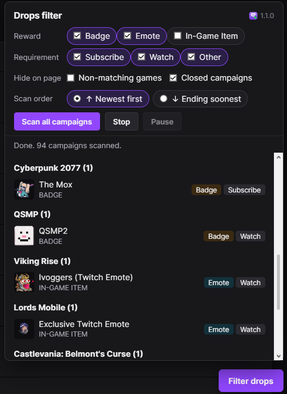

# Twitch Drops Filter

A small browser extension (Opera / Chromium) that filters **Open Drop Campaigns** on
[twitch.tv/drops/campaigns](https://www.twitch.tv/drops/campaigns) by reward type and requirement,
so you can quickly find the drops you actually want.

> **Unofficial.** Not affiliated with, endorsed by, or sponsored by Twitch Interactive, Inc.
> "Twitch" is a trademark of Twitch Interactive, Inc.

## Screenshot

## Features

- **Filter by reward:** Badge, Emote, In-Game Item
- **Filter by requirement:** Subscribe, Watch, Other
- **Hide on page:** hide games with no matching reward, and optionally the *Closed Drop Campaigns* section
- **Scan all campaigns:** opens each campaign, reads its rewards and lists the matches in a panel (with Stop and Pause)
- **Scan order:** newest first or ending soonest first
- Click a game in the results to jump to it on the page
- Settings are remembered between visits

The panel only appears on the Drops campaigns page.

## Install

### Opera / Chrome / Edge (from source)
1. Download this repository (**Code → Download ZIP**) and unzip it.
2. Open `opera://extensions` (or `chrome://extensions`) and enable **Developer mode**.
3. Click **Load unpacked** and choose the `extension` folder.
4. Open [twitch.tv/drops/campaigns](https://www.twitch.tv/drops/campaigns) and click **Filter drops**.

> The extension uses Manifest V2, which works in Opera. Recent Chrome versions no longer load MV2 extensions.

## How it works

Twitch is a single-page app, so the content script loads on twitch.tv and switches itself on or off
depending on the current path. It reads the campaign accordions on the page, classifies each reward by its text,
and shows or hides elements accordingly. Nothing leaves your browser.

If Twitch changes its wording or layout, edit the rules at the top of `extension/content.js`
(`REWARD_TYPES`, `REQ_TYPES`, section headings).

## Privacy

No tracking, no analytics, no external requests. See [PRIVACY.md](PRIVACY.md).

## Built with AI

This extension was created with AI tools. The idea, testing, and direction were human-driven, while the code was generated through AI prompting and iteration.

## License

[MIT](LICENSE)
